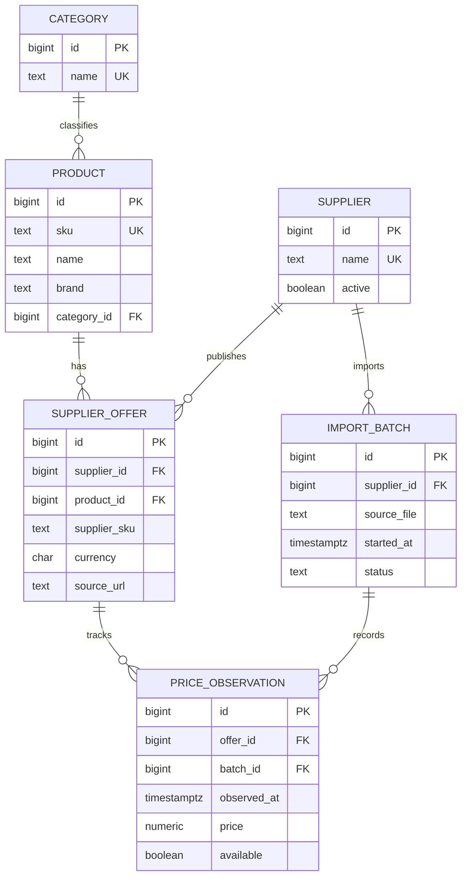

# Entity-relationship diagram

One supplier offer is one supplier's listing of one catalog product. A price observation belongs to both an offer and an import batch. A composite foreign key ensures both refer to the same supplier.
