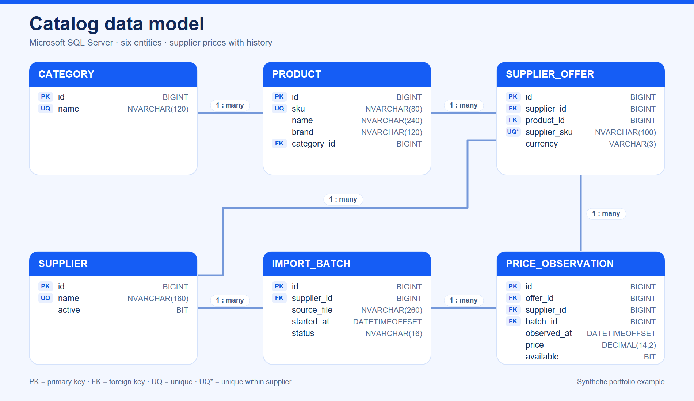
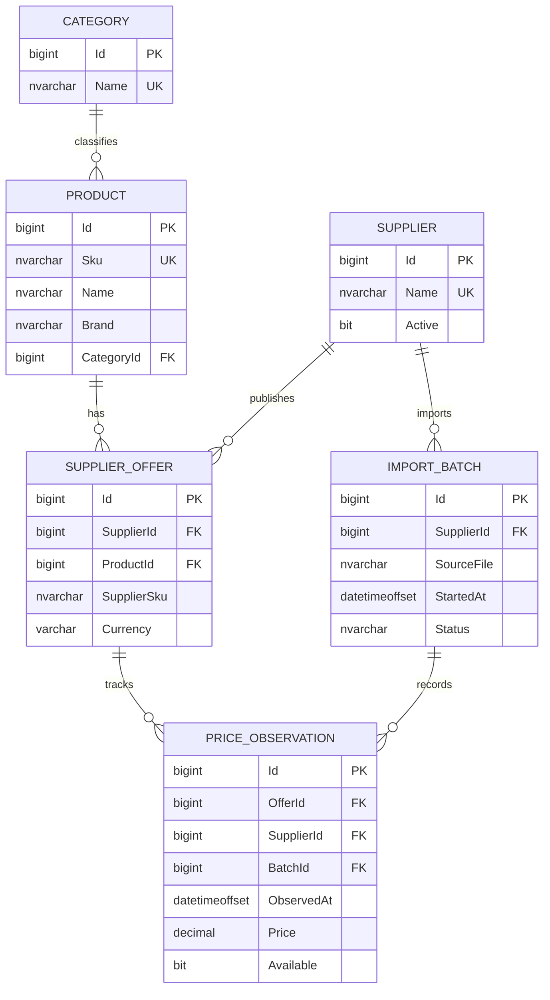

# Entity-relationship diagram

The PNG below is useful in proposals. The Mermaid definition is editable in Markdown and rendered directly by GitHub.

The observation's `SupplierId` participates in two composite foreign keys. This prevents attaching an offer from one supplier to an import batch from another supplier.
